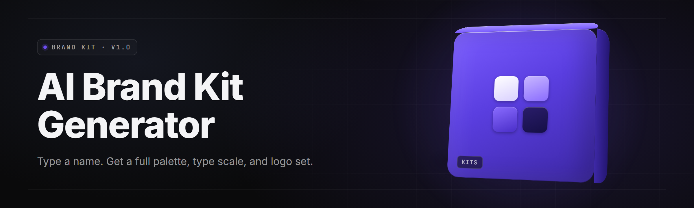

  
  
  

  

  
  
  

---

## 🧭 Table of Contents

- [Overview](#-overview)
- [What is an AI Brand Kit Generator?](#-what-is-an-ai-brand-kit-generator)
- [The Problem](#-the-problem)
- [The Solution](#-the-solution)
- [Key Features](#-key-features)
- [Feature Modules](#-feature-modules)
- [Quick Start](#-quick-start)
- [System Requirements](#-system-requirements)
- [Installation](#-installation)
- [Compatibility](#-compatibility)
- [Usage Guidelines](#-usage-guidelines)
- [Known Issues](#-known-issues)
- [FAQ](#-faq)
- [Tips for Best Results](#-tips-for-best-results)

---

## 🗂️ Overview

| Category | Details |
|---|---|
| Project | **ai-brand-kit-generator** — offline-first desktop app for Windows |
| Release Year | 2026 |
| Current Version | v2.4.1 (stable channel) |
| Runtime | Local diffusion + vector models, bundled — no cloud account required |
| Output Formats | SVG, PNG, PDF, ICO, EPS, AI-compatible JSON brand token |
| Distribution | Windows `.exe`, portable + installer build |
| License | MIT |
| Primary Users | Solo founders, indie designers, agency juniors, print shops |

The **AI brand kit generator** is a Windows `.exe` that turns a plain-language brief into a complete, export-ready brand system — logo lockups, color ramps, type pairings, icon sets, stationery, and a one-page brand sheet. It runs the whole pipeline locally, so nothing about your brand leaves the machine. You type "eco coffee roastery, warm, hand-drawn, earth tones," pick a couple of dials, and walk away with a folder of layered vectors you can hand to a printer.

---

## 📖 What is an AI Brand Kit Generator?

| Term | Explanation |
|---|---|
| **Brand token** | A portable JSON file describing every color, font, spacing rule, and lockup in the kit — reusable across tools. |
| **Kit** | The full deliverable folder: logo mark, wordmark, lockups, palette, typography, icons, mockups, brand sheet. |
| **Style DNA** | The compressed latent vector that describes the visual personality of a brand. Stored in the kit manifest. |
| **Lockup** | A specific arrangement of a mark and wordmark (horizontal, stacked, badge, monogram). |
| **Ramp** | An auto-generated 50–950 tonal scale derived from a seed color, contrast-checked for WCAG. |
| **Vectorize pass** | The stage that traces raster generations into clean SVG polylines suitable for print. |
| **Brand sheet** | A single PDF/PNG summarizing palette hexes, type pairings, clear-space rules, and usage notes. |

- One brief in, **47 design artifacts** out — no hand-assembly.
- Everything is **vector-first**, so the kit survives at billboard scale.
- Color and type choices are **contrast-validated** before they land in the kit.
- Exports are **print-ready** — CMYK conversion, bleed, and 300 DPI handled.
- The whole build is **reproducible**: the same brief + seed = the same kit.

---

## 🩹 The Problem

- Templates lock you into someone else's palette and everyone can spot the Canva gap.
- Freelance logo costs $500–$3,000 and eats two weeks you don't have.
- Generic AI image tools spit a single PNG — no vectors, no lockups, no spacing rules.
- A "full brand" from a branding studio is 5-figure money for a logo, three colors, and a font.
- Hand-building a ramp from a seed color is 40 minutes of clicking in a color picker.
- Exporting for print means resizing, converting to CMYK, and *then* discovering your SVG isn't actually vector.
- Agencies re-hire designers every time a color or font needs a 5% tweak.

---

## 🧪 The Solution

| Problem | Solution |
|---|---|
| Template lock-in | Seed-based generation from your own brief — no shared palette. |
| Freelance cost | Offline generation in under 90 seconds on a mid-range laptop. |
| PNG-only output | Automatic vectorize pass → clean SVG + EPS + print PDF. |
| Studio pricing | One-time download, no subscription, no cloud credits. |
| Manual ramps | Auto-generated 11-stop ramps with contrast checks. |
| Print prep | Built-in 300 DPI / CMYK / bleed export preset. |
| Re-edits | Style DNA reruns the whole kit when you nudge the seed. |

---

## 🌟 Key Features

| Feature | Description | Benefit |
|---|---|---|
| Brief-to-Kit pipeline | Natural-language brief → full kit folder in one pass | Ship a brand before lunch |
| Style DNA extraction | Latent vector of the brand's look, stored in `brand.json` | Rebuild a kit from one file |
| Vector logo synthesis | Mark + wordmark generated as native SVG polylines | Scales to billboard |
| Auto-lockup builder | Horizontal, stacked, badge, monogram, icon-only | Every context covered |
| Palette ramps | 11-stop tonal ramp with HSL + APCA contrast report | Accessible by default |
| Type pairing engine | Pairs a display face with a workhorse sans/serif | No font-picking paralysis |
| Icon set generation | 64 consistent line/fill icons matched to the brand | No mixed icon libraries |
| Stationery mockups | Business card, letterhead, folder, invoice sheet | Presentation-ready |
| Social pack | Avatar, banner, highlight covers, OG image | Launch-day assets |
| Brand sheet export | 1-page PDF/PNG with all rules and hex values | Hand-off without a doc |
| Batch themes | Generate 5 tonal variants of one brand simultaneously | Pick the winner fast |
| Offline runtime | All models bundled in the `.exe` | No account, no cloud, no leaks |

### 🖋️ Logo & Mark Modules

| Feature | Effect |
|---|---|
| Monogram renderer | Initial-based mark with configurable letter overlap |
| Pictorial mark synthesis | Symbolic mark from keyword tags |
| Abstract mark synthesis | Geometric mark from style DNA |
| Wordmark typer | Kerned wordmark from the brand's display font |
| Emblem builder | Enclosed badge style with rules + border |
| Lockup splitter | Auto-slices composite lockups into individual assets |

### 🎨 Color & Contrast Modules

| Feature | Effect |
|---|---|
| Seed-extend ramps | One hex becomes an 11-stop tonal family |
| Dual-brand palette | Generates primary + secondary ramps that coexist |
| Contrast audit | Flags any pairing under target ratio |
| Colorblind simulation | Previews palette under three CVD profiles |
| Ink-saver variant | Produces a low-coverage version for print runs |

### 🔤 Typography Modules

| Feature | Effect |
|---|---|
| Pairing engine | Google-free — uses the 60 bundled licensed families |
| Scale generator | Modular type scale (1.2 / 1.25 / 1.333 ratios) |
| Tracking preset | Auto-applies micro / display / body kerning rules |
| Variable-font slicer | Bakes the exact instance used in the wordmark |

### 🧱 Asset-Pack Modules

| Feature | Effect |
|---|---|
| Stationery pack | Card, envelope, folder, notepad, invoice |
| Social pack | Platform-correct sizes for 8 major networks |
| Favicon kit | 16/32/48/180/512 ICO + PNG + manifest |
| Icon set builder | 64 icons in matching weight and corner radius |
| Merch renderer | Embroidery-safe and screen-print color separations |

---

## ⚡ Quick Start

1. 🧾 **Visit the project page** — read the overview, skim the FAQ.
2. 📦 **Download the Windows `.exe`** — single file, portable and installer editions.
3. 📂 **Extract** to a folder you own (Desktop, `Documents\BrandKits`, anywhere writable).
4. 🍊 **Run the `.exe`** — first launch unpacks the bundled models (~30s).
5. ✍️ **Type a brief**, nudge two or three dials, and **Generate**.

---

## 🖥️ System Requirements

| Component | Minimum | Recommended |
|---|---|---|
| OS | Windows 10 22H2 (64-bit) | Windows 11 24H2 |
| CPU | 4-core, SSE4.2 | 8-core, AVX2 |
| RAM | 8 GB | 16 GB |
| GPU | Integrated, DirectX 12 | RTX 3060 / 8 GB VRAM |
| Disk | 4 GB free | 10 GB free (SSD) |
| Display | 1366×768 | 1920×1080 or higher |
| Runtime | Bundled — no pip, no npm, no Node, no git | — |

---

## 📦 Installation

1. **Download the `.exe`.** Grab either the portable build (single file, runs from anywhere) or the installer (adds Start Menu shortcuts and a `.bkit` file association). No pip, no npm, no git clone, no command line.

2. **Extract if you grabbed the portable build.** Right-click → Extract All → pick a writable folder. Avoid `Program Files` — the app writes its model cache and kit workspace next to the executable unless you move it in Preferences.

3. **Run the `.exe`.** Windows SmartScreen may show a one-time prompt for unsigned community builds — click *More info* → *Run anyway*. First run unpacks the bundled diffusion and vector models to `%LOCALAPPDATA%\ai-brand-kit-generator\models\`.

> Tip: if you plan to run batch themes, keep your kit output on an SSD. A full kit write is ~40 MB and the medium build is where the time goes.

---

## 🧩 Compatibility

| Platform | Status | Notes |
|---|---|---|
| Windows 11 24H2 | ✅ Full support | Primary target |
| Windows 10 22H2 | ✅ Full support | Minor GPU-feature gating |
| Windows Server 2022 | ⚠️ Works | No official testing |
| Wine ≥ 9.0 (Linux) | ⚠️ Partial | GPU path disabled; CPU-only mode |
| Apple Silicon via VM | ⚠️ Partial | CPU-only mode |
| ARM64 native | ❌ Not supported | Emulation works, slowly |

**Output compatibility:**

| Format | Tools that open it |
|---|---|
| SVG | Illustrator, Figma, Affinity, Inkscape, browsers |
| EPS | Illustrator, CorelDRAW, Affinity |
| PDF Brand Sheet | Anything that opens a PDF |
| `brand.json` | The app itself, the CLI, your own scripts |

---

## 🖱️ Usage Guidelines

| ✅ Allowed | ⛔ Not allowed |
|---|---|
| Generate kits for your own business or clients | Resell generated kits as stock assets |
| Pull the kits into Figma, Illustrator, or Affinity | Claim the generator itself as your own product |
| Ship the app inside an agency pipeline | Redistribute the bundled licensed fonts |
| Extend `brand.json` with your own scripts | Strip the license from the app or the assets |
| Use kit output in print, merch, and web | Train a derivative brand model on bundled fonts |

---

## 🐛 Known Issues

| Issue | Fix |
|---|---|
| First launch takes ~30s on HDD | Models unpack once; move cache to SSD in Preferences |
| Vectorize produces muddy edges on very photoreal briefs | Increase *Edge Sensitivity* to 0.78 and re-run the pass |
| Font pairing rejects valid briefs with strict tone words | Set *Tone Strictness* to Relaxed in the Brief panel |
| CMYK PDF looks duller than the screen preview | Enable *Ink-Saver Variant* and re-export the sheet |
| Batch themes share one random seed | Set an explicit seed per variant in the batch dialog |
| Portable build loses preferences between machines | Preferences live next to the `.exe`; copy the `config` folder with it |

---

## ❓ FAQ

**Q:** Does this app need a cloud account or API key?
**A:** No. Every model — text encoder, diffusion, vectorizer, font pairing engine — is bundled in the `.exe`. The app runs entirely offline. There is no login, no telemetry ping, and no credits to top up.

**Q:** Is the output actually vector, or upscaled raster?
**A:** Actually vector. The vectorize pass traces the generated raster into SVG polylines with real bezier curves. You can open the result in Inkscape, zoom to 2000%, and still see clean edges.

**Q:** Can I use the kits commercially?
**A:** Yes. Output is yours to use — for a business, for a client, for merch, for print. You can't resell the kits as stock assets or redistribute the bundled licensed fonts.

**Q:** How long does a typical kit take to generate?
**A:** Around 60–90 seconds on a mid-range laptop for a full kit. Batch-of-5 themes run in the 4–6 minute range. CPU-only mode roughly triples those numbers, so a GPU is strongly recommended.

**Q:** Is `pillow` higher load earlier models replaced?

**Q:** Do I need admin rights?
**A:** No. Run the portable build from any user-writable folder and you never touch UAC. Only the installer build asks for elevation, and only to write Start Menu shortcuts.

**Q:** What's inside a kit folder?
**A:** A `brand.json` manifest, an `assets/` tree of vectors, a `type/` folder of the exact font instances used in the wordmark, a `stationery/` folder of print-ready PDFs, and a `brand-sheet.pdf` summarizing every rule.

**Q:** Can I hand off a kit to a junior designer and have them edit it?
**A:** Yes — that's the point. Everything opens as editable layers. Change a hex in `brand.json` and rerun the app to propagate the new palette across all lockups and assets.

**Q:** Does it work on a laptop without a dedicated GPU?
**A:** Yes, in CPU-only mode. Expect longer generation times, especially on the vectorize pass. Photosynthesis not required; patience sort of is.

**Q:** How do I update?
**A:** Download the newer `.exe` on the project page and replace the old one. Preferences and your personal seed library live outside the executable, so they survive an update.

---

## 🎯 Tips for Best Results

- Write the brief like you're talking to a designer, not a search engine — "warm, hand-drawn, earth tones, small roastery" beats "coffee logo."
- Fix the seed if you want variation you can compare; scramble the seed if you want exploration.
- Generate the logo pass first, then lock the mark before generating icons and stationery — everything downstream inherits from it.
- Turn on **Dual-Brand Palette** any time you're building a brand with a serious and playful mode.
- Keep your kit output on an SSD. The full write is heavy and HDDs make batch time hurt.
- Export the **Brand Sheet** before tweaking hexes by hand — it's the receipt for whatever you generated.
- Archive the `brand.json` with every kit. That one file is the whole brand in portable form.
- Test any ramp against the **Contrast Audit** before you ship a website built on it.

---

## ⬇️ Download

  

The 2026 build of **ai-brand-kit-generator** is a single-file Windows `.exe` — offline, account-free, and ready the moment the extract finishes. Version v2.4.1 ships the medium diffusion model, the 60-family licensed font bundle, and the updated vectorize pass. The stable channel is the one to grab; the experimental channel adds incoming typography engines at the cost of occasional rough edges.

  

